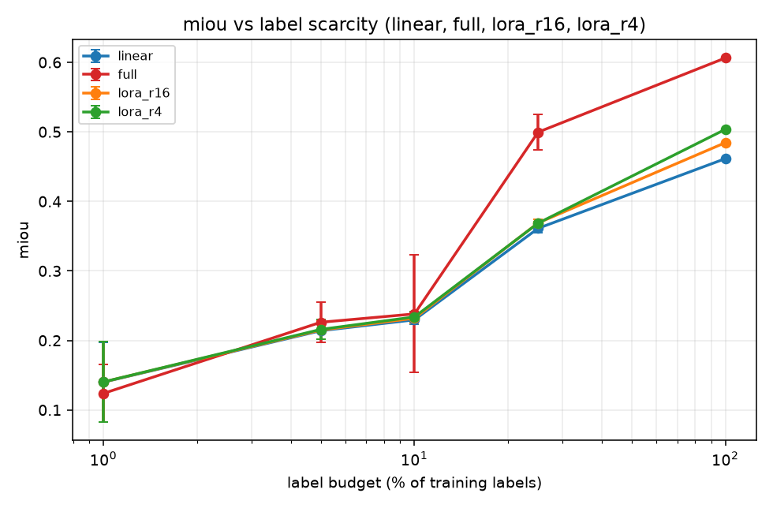
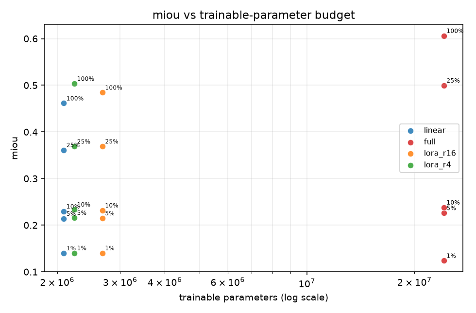
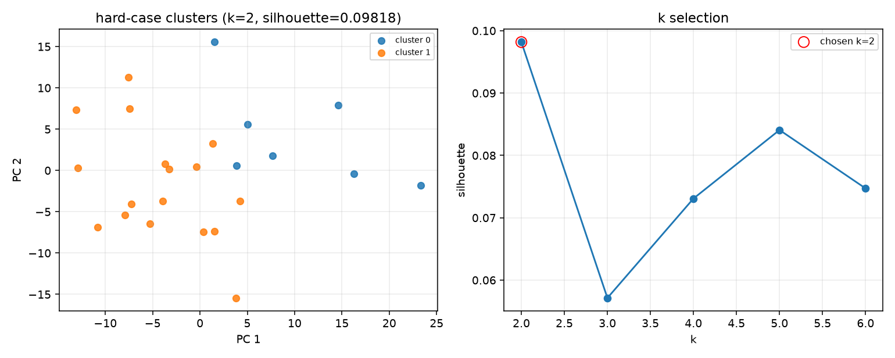
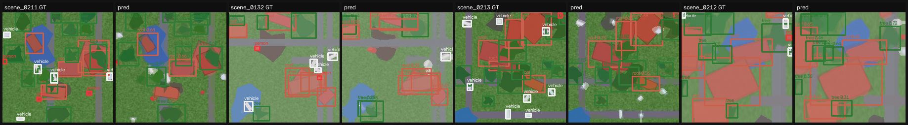
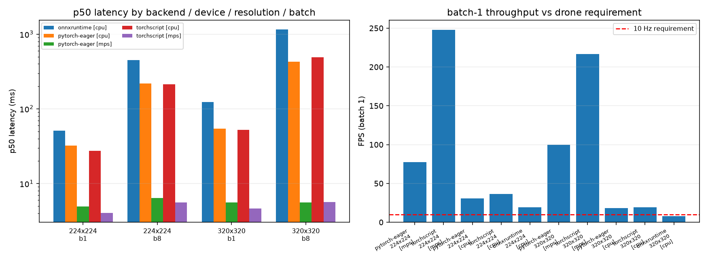

# AerialObstacleViT

**Obstacle and landing-zone perception for low-altitude drone delivery — a
perception benchmark for frozen foundation features versus open-vocabulary
vision-language models.**

A delivery UAV descending into an urban or semi-urban scene has to answer two
questions at once, from a single nadir or near-nadir frame: *what is down there
that I must not hit* (roofs, trees, water, people, vehicles) and *where can I
actually put down* (flat, clear, obstacle-free ground). That is a dense
prediction problem on imagery whose viewpoint — straight down, from 30–120 m —
almost never appears in the web-scale datasets that pretrained vision models
learn from. This repository asks whether that mismatch can be absorbed by a
*frozen* foundation backbone and a cheap task head, or whether a generic
open-vocabulary vision-language model can already answer the question zero-shot.

**Research question.** For obstacle and landing-zone perception on drone imagery,
how do frozen self-supervised ViT foundation-model features (DINOv2) compare to
open-vocabulary VLM zero-shot detection (OWL-ViT / CLIP), and how does that
trade-off change under label scarcity?

The benchmark therefore measures three things on one shared taxonomy, one shared
train/val/test split and one shared metric implementation:

1. **Task-trained DINOv2.** `facebook/dinov2-small` frozen, with a linear probe,
   a small conv decoder and an anchor-free FCOS-lite box head trained on top.
2. **Open-vocabulary zero-shot.** `google/owlvit-base-patch32` and a
   `openai/clip-vit-base-patch32` dense sliding-window classifier, driven only by
   text prompts — no training, no prompt tuning.
3. **The label-scarcity axis.** The same adaptation modes swept across 1 %, 5 %,
   10 %, 25 % and 100 % of the training labels, because the practical question on
   a new airframe and a new city is not "which model is best" but "which model is
   best when I have forty labelled frames".

Everything beyond that — hard-case mining, failure-mode clustering, ONNX export
and latency — exists to answer the follow-up question: *when it fails, how does
it fail, and can it still run on board?*

---

## 1. Architecture

```
                      ┌─────────────────────────────┐
                      │  Semantic Drone Dataset      │   (real, if reachable)
                      │  ─ or ─                      │
   scripts/fetch_data │  synthetic nadir generator   │   (deterministic fallback)
   ─────────────────► │  + canonical 8-class remap   │
                      └──────────────┬───────────────┘
                                     │  image / mask / boxes / landing-zone
                                     ▼
                      ┌─────────────────────────────┐
                      │  frozen DINOv2-small  ViT    │   22.1 M params, 14 px patch
                      │  forward_features / cls_token│   0 trainable in probe mode
                      └───────┬─────────────┬───────┘
                              │             │
              patch tokens    │             │   CLS token (embeddings)
                              ▼             ▼
        ┌───────────────────────────┐   ┌──────────────────────────────┐
        │  task heads               │   │  hard-case mining (Step 5)    │
        │   • LinearSegHead (probe) │   │   entropy / margin / MC-drop  │
        │   • ConvSegHead (decoder) │   │   kNN OOD vs train embeddings │
        │   • BoxHead (FCOS-lite)   │   │   KMeans + auto-tagging       │
        └──────────┬────────────────┘   └──────────────────────────────┘
                   │
                   │        ┌──────────────────────────────────────────┐
                   │        │  zero-shot branch (Step 3)                │
                   │        │   OWL-ViT: text queries -> boxes          │
                   │        │   CLIP: sliding window -> dense labels    │
                   │        │   prompt ensembling over templates        │
                   │        └──────────────────┬───────────────────────┘
                   ▼                           ▼
        ┌──────────────────────────────────────────────────────────────┐
        │  eval/metrics.py   mIoU · per-class IoU · pixel acc           │
        │                    landing-zone IoU/F1 · COCO mAP@0.5/[.5:.95]│
        │                    rare-class mAP (measured, not assumed)     │
        └──────────────────────────┬───────────────────────────────────┘
                                   ▼
        ┌──────────────────────────────────────────────────────────────┐
        │  export + latency (Step 6)                                    │
        │   TorchScript · ONNX opset 17 (dynamic batch) · parity checks  │
        │   eager vs TorchScript vs ONNX Runtime, batch 1 & 8, 2 sizes   │
        │   -> onboard feasibility vs a stated 10 Hz requirement         │
        └──────────────────────────────────────────────────────────────┘
```

### Module layout

| Path | Responsibility |
|---|---|
| `aerial_vit/config.py` | Dataclass configs (`RunCfg`, `DataCfg`, `BackboneCfg`, `ModelCfg`, `TrainCfg`, `EvalCfg`, `AblationCfg`) loaded from `configs/*.yaml` |
| `aerial_vit/data/synthetic.py` | Deterministic procedural nadir-scene generator with pixel-perfect masks, instance boxes, occlusion statistics, and glare/motion-blur/haze/altitude degradations |
| `aerial_vit/data/semantic_drone.py` | Canonical-layout dataset, 20+ class → 8-class taxonomy remap, landing-zone derivation, data manifest, stratified label sub-sampling |
| `aerial_vit/data/transforms.py` | Resize/crop/normalise (ImageNet stats) plus flip, colour jitter and random-scale (altitude) augmentation, box-aware |
| `aerial_vit/models/dinov2_backbone.py` | Frozen DINOv2 wrapper: `forward_features`, `cls_token`, `freeze`/`unfreeze`, trainable-parameter accounting, no-download presets |
| `aerial_vit/models/heads.py` | `LinearSegHead` (probe), `ConvSegHead` (decoder), `BoxHead` (FCOS-lite), `AerialPerceptionModel`, segmentation and detection losses |
| `aerial_vit/models/lora.py` | Native `LoRALinear` + PEFT backend, injection/merge, trainable-vs-total accounting |
| `aerial_vit/models/openvocab.py` | OWL-ViT and CLIP zero-shot wrappers with multi-template prompt ensembling and canonical label mapping |
| `aerial_vit/eval/metrics.py` | Confusion-matrix mIoU, landing-zone IoU/F1, COCO mAP via pycocotools, rare-class restriction |
| `aerial_vit/eval/uncertainty.py` | Predictive entropy, margin, MC-dropout variance, kNN OOD distance, stable top-K ranking |
| `aerial_vit/eval/hardcases.py` | Scene statistics, silhouette-selected KMeans, failure-mode auto-tagging, per-cluster metric deltas |
| `aerial_vit/train_engine.py` | One training loop + one evaluation path shared by `train`, `eval`, `ablate` and hard-case mining |
| `aerial_vit/ablation.py` / `aerial_vit/reporting.py` | Sweep grid + aggregation + figures; report tables rendered from artifacts only |
| `aerial_vit/export.py` / `aerial_vit/benchmark.py` | TorchScript/ONNX export with parity checks; warmup-corrected p50/p95 latency benchmarking |
| `scripts/*.py` | Thin Typer shims — `python scripts/train.py …` is the same code path as `aerialvit train …` |

---

## 2. How to run

```bash
# 1. environment (Python 3.11)
uv venv --python 3.11 .venv
uv pip install --python .venv/bin/python -e ".[dev]"

# 2. data: the real Semantic Drone Dataset if reachable, else the deterministic
#    synthetic fallback. The active source is recorded in artifacts/data_manifest.json
python scripts/fetch_data.py --config configs/full.yaml --force
# or point at a local copy / URL:
#   python scripts/fetch_data.py --config configs/full.yaml --src /path/to/semantic_drone

# 3. train / evaluate the task model
aerialvit train --config configs/full.yaml --mode linear --run-name full_linear
aerialvit eval  --config configs/full.yaml --run-name full_linear

# 4. open-vocabulary zero-shot baselines + comparison table
aerialvit zeroshot --config configs/full.yaml --method both --task-run full_linear

# 5. label-scarcity ablation (linear / LoRA r4 / LoRA r16 / full x 1..100 % labels)
aerialvit ablate --config configs/ablate.yaml

# 6. hard-case mining, failure-mode clustering, targeted retrain
aerialvit mine-hard-cases --config configs/ablate.yaml --run-name full_linear

# 7. export + latency
aerialvit export       --config configs/full.yaml --run-name full_linear
aerialvit bench-latency --config configs/full.yaml --run-name full_linear --iterations 50

# 8. tests, coverage, and the report tables
aerialvit quality
aerialvit make-report

# everything, in order, from scratch:
bash scripts/run_all.sh
```

Adapters: `--mode linear` (frozen backbone, linear probe), `--mode lora_r16`
(frozen backbone + rank-16 LoRA on q/k/v/o projections), `--mode full`
(everything trainable). `--label-fraction 0.05` trains on 5 % of the training
split, stratified so rare classes survive.

### Docker (CPU-only image)

```bash
docker build -t aerialvit .
docker run --rm aerialvit --help
docker run --rm -v "$PWD/artifacts:/app/artifacts" aerialvit \
    fetch-data --config configs/smoke.yaml
```

### What was actually run for the numbers below

| field | value |
|---|---|
| data source | synthetic |
| data detail | synthetic procedural fallback (deterministic) |
| train / val / test frames | 192 / 40 / 40 |
| classes | background, paved-area, grass, roof, tree, water, person, vehicle |
| rare classes (measured) | person |
| image size | [224, 224] |
| per-class pixel fraction | {"background": 0.016427, "grass": 0.652983, "paved-area": 0.077238, "person": 0.001929, "roof": 0.141753, "tree": 0.086324, "vehicle": 0.011138, "water": 0.012208} |

| | |
|---|---|
| device used for every measured number | `apple-mps (Metal Performance Shaders)` |
| python / torch | `3.11.14` / `2.14.1` |
| commit at generation time | `e5b0fbaa988949cdd9e406ff7d27e21ef575787c` |
| generated | `2026-10-15` |

> If the Semantic Drone Dataset could not be reached from the build machine, the
> manifest records `source: synthetic` and every number below is measured on the
> deterministic procedural fallback. **No number in this README is estimated.**

---

## 3. Results

All tables in this section are rendered from `artifacts/` by
`python scripts/make_report.py` into `reports/tables/*.md`, and are included here
verbatim. [reports/RESULTS.md](reports/RESULTS.md) contains the same content.

- **Frozen features beat open-vocabulary zero-shot by a wide margin.** DINOv2 (frozen) + linear head reaches mIoU **0.4967**, landing-zone IoU **0.8835** and mAP@0.5 **0.3658**, versus owlvit (zero-shot) mIoU 0.0751, mAP@0.5 0.1853; clip (zero-shot) mIoU 0.0755, mAP@0.5 0.0002.
- **Best overall model:** `full` at a 100% label budget, mIoU **0.6063** with **24,140,309** trainable parameters (100.00% of the network).
- **Label scarcity flips the ranking.** At a 1% budget the linear probe (2,083,733 trainable) reaches mIoU **0.1400**, while `full` (24,140,309 trainable) is **-0.0162** mIoU relative to it - more capacity is *worse* when labels are scarce, and only pays off past the ~25% mark.
- **Onboard:** best batch-1 throughput **247.69 FPS** (`torchscript`, 224x224) against a 10 Hz streaming requirement -> **feasible** (CPU-only ONNX Runtime: 19.26 FPS).
- **Worst failure cluster:** `dense-objects` (27 test frames), mIoU 0.5713 vs split 0.6063 (**delta -0.0350**); retraining with the mined hard frames moves overall mIoU 0.6063 -> control 0.6335 -> +hard **0.6388** (delta vs control **0.0053**).
- **Quality:** 162 tests passing (2 slow tests deselected), **72.4% coverage**, ruff clean.

### 3.1 Foundation features vs open-vocabulary VLMs

| method | trainable params | total params | trainable % | mIoU | landing-zone IoU | mAP@0.5 | rare-class mAP@0.5 | ms/img | device |
|---|---|---|---|---|---|---|---|---|---|
| DINOv2 (frozen) + linear head | 2,083,733 | 24,140,309 | 8.632 % | 0.4967 | 0.8835 | 0.3658 | 0.0000 | 88.3 | apple-mps (Metal Performance Shaders) |
| owlvit (zero-shot) | 0 | 153,231,879 | 0.000 % | 0.0751 | 0.6658 | 0.1853 | 0.0050 | 273.3 | apple-mps (Metal Performance Shaders) |
| clip (zero-shot) | 0 | 151,277,313 | 0.000 % | 0.0755 | 0.4350 | 0.0002 | 0.0000 | 789.3 | apple-mps (Metal Performance Shaders) |

### 3.2 Label scarcity: linear probe vs LoRA vs full fine-tune

| mode | trainable params | trainable % | 1% | 5% | 10% | 25% | 100% |
|---|---|---|---|---|---|---|---|
| linear | 2,083,733 | 8.63 % | 0.1400 ± 0.0577 (n=2) | 0.2140 ± 0.0122 (n=2) | 0.2296 ± 0.0062 (n=2) | 0.3613 ± 0.0062 (n=2) | 0.4615 ± 0.0000 (n=1) |
| lora_r4 | 2,231,189 | 9.19 % | 0.1403 ± 0.0580 (n=2) | 0.2159 ± 0.0141 (n=2) | 0.2338 ± 0.0071 (n=2) | 0.3687 ± 0.0025 (n=2) | 0.5036 ± 0.0000 (n=1) |
| lora_r16 | 2,673,557 | 10.81 % | 0.1403 ± 0.0579 (n=2) | 0.2149 ± 0.0132 (n=2) | 0.2319 ± 0.0078 (n=2) | 0.3690 ± 0.0056 (n=2) | 0.4844 ± 0.0000 (n=1) |
| full | 24,140,309 | 100.00 % | 0.1239 ± 0.0417 (n=2) | 0.2261 ± 0.0289 (n=2) | 0.2381 ± 0.0845 (n=2) | 0.4996 ± 0.0250 (n=2) | 0.6063 ± 0.0000 (n=1) |

Landing-zone quality under the same sweep:

| mode | trainable params | trainable % | 1% | 5% | 10% | 25% | 100% |
|---|---|---|---|---|---|---|---|
| linear | 2,083,733 | 8.63 % | 0.7230 ± 0.0064 (n=2) | 0.7539 ± 0.0042 (n=2) | 0.7907 ± 0.0230 (n=2) | 0.8492 ± 0.0011 (n=2) | 0.8746 ± 0.0000 (n=1) |
| lora_r4 | 2,231,189 | 9.19 % | 0.7229 ± 0.0065 (n=2) | 0.7549 ± 0.0045 (n=2) | 0.7917 ± 0.0215 (n=2) | 0.8383 ± 0.0063 (n=2) | 0.8661 ± 0.0000 (n=1) |
| lora_r16 | 2,673,557 | 10.81 % | 0.7230 ± 0.0064 (n=2) | 0.7540 ± 0.0044 (n=2) | 0.7922 ± 0.0209 (n=2) | 0.8456 ± 0.0048 (n=2) | 0.8874 ± 0.0000 (n=1) |
| full | 24,140,309 | 100.00 % | 0.7523 ± 0.0248 (n=2) | 0.7242 ± 0.0214 (n=2) | 0.8090 ± 0.0117 (n=2) | 0.8684 ± 0.0036 (n=2) | 0.9061 ± 0.0000 (n=1) |

Detection mAP@0.5:

| mode | trainable params | trainable % | 1% | 5% | 10% | 25% | 100% |
|---|---|---|---|---|---|---|---|
| linear | 2,083,733 | 8.63 % | 0.0357 ± 0.0040 (n=2) | 0.0616 ± 0.0136 (n=2) | 0.0990 ± 0.0293 (n=2) | 0.2264 ± 0.0063 (n=2) | 0.3350 ± 0.0000 (n=1) |
| lora_r4 | 2,231,189 | 9.19 % | 0.0358 ± 0.0038 (n=2) | 0.0613 ± 0.0127 (n=2) | 0.0950 ± 0.0280 (n=2) | 0.2307 ± 0.0037 (n=2) | 0.3482 ± 0.0000 (n=1) |
| lora_r16 | 2,673,557 | 10.81 % | 0.0357 ± 0.0038 (n=2) | 0.0617 ± 0.0135 (n=2) | 0.0945 ± 0.0281 (n=2) | 0.2271 ± 0.0074 (n=2) | 0.3367 ± 0.0000 (n=1) |
| full | 24,140,309 | 100.00 % | 0.0227 ± 0.0227 (n=2) | 0.0593 ± 0.0057 (n=2) | 0.0702 ± 0.0125 (n=2) | 0.2915 ± 0.0195 (n=2) | 0.3964 ± 0.0000 (n=1) |

Adaptation cost (the reason any of this matters on a drone):

| mode | trainable params | total params | trainable % | cells | seeds/cell (avg) | train s/cell (avg) | peak MB (max) |
|---|---|---|---|---|---|---|---|
| linear | 2,083,733 | 24,140,309 | 8.632 % | 5 | 1.8 | 63.2 | 1407.2 |
| lora_r4 | 2,231,189 | 24,287,765 | 9.187 % | 5 | 1.8 | 77.3 | 2589.4 |
| lora_r16 | 2,673,557 | 24,730,133 | 10.811 % | 5 | 1.8 | 62.6 | 2606.2 |
| full | 24,140,309 | 24,140,309 | 100.000 % | 5 | 1.8 | 79.2 | 2714.2 |





### 3.3 Hard cases and failure modes

| cluster | auto tag | n frames | mIoU | split mIoU | Δ mIoU | mAP@0.5 | split mAP@0.5 | Δ mAP@0.5 |
|---|---|---|---|---|---|---|---|---|
| 0 | low-contrast/haze | 13 | 0.5825 | 0.6063 | -0.0238 | 0.4185 | 0.3964 | 0.0221 |
| 1 | dense-objects | 27 | 0.5713 | 0.6063 | -0.0350 | 0.3911 | 0.3964 | -0.0053 |



Representative hardest frames -- ground truth on the left, predictions on the right:



Targeted retrain on the mined hard set:

| scope | mIoU before | mIoU control | mIoU after | Δ mIoU vs before | Δ mIoU vs control | Δ mAP@0.5 vs before | Δ mAP@0.5 vs control |
|---|---|---|---|---|---|---|---|
| **overall** | 0.6063 | 0.6335 | 0.6388 | 0.0325 | 0.0053 | 0.0235 | -0.0105 |
| cluster 0 (low-contrast/haze) | 0.6107 | 0.6428 | 0.6425 | 0.0318 | -0.0003 | 0.0088 | -0.0370 |
| cluster 1 (dense-objects) | 0.6039 | 0.6256 | 0.6360 | 0.0320 | 0.0104 | 0.0251 | -0.0024 |

_control = identical warm-start and epochs, trained **without** the mined hard frames; `vs control` therefore isolates the effect of the hard examples themselves. 24 hard frames were added, up-weighted x3._

### 3.4 Latency and onboard feasibility

| backend | resolution | batch | mean ms | p50 ms | p95 ms | FPS | device |
|---|---|---|---|---|---|---|---|
| pytorch-eager | 224x224 | 1 | 12.94 | 4.90 | 5.22 | 77.26 | apple-mps (Metal Performance Shaders) |
| torchscript | 224x224 | 1 | 4.04 | 4.01 | 4.16 | 247.69 | apple-mps (Metal Performance Shaders) |
| pytorch-eager | 224x224 | 1 | 32.57 | 32.07 | 38.47 | 30.70 | cpu |
| torchscript | 224x224 | 1 | 27.47 | 27.44 | 28.23 | 36.41 | cpu |
| onnxruntime | 224x224 | 1 | 51.92 | 50.99 | 57.73 | 19.26 | cpu (CPUExecutionProvider) |
| pytorch-eager | 224x224 | 8 | 6.87 | 6.36 | 7.54 | 1164.02 | apple-mps (Metal Performance Shaders) |
| torchscript | 224x224 | 8 | 6.07 | 5.58 | 8.37 | 1317.22 | apple-mps (Metal Performance Shaders) |
| pytorch-eager | 224x224 | 8 | 223.60 | 219.44 | 255.00 | 35.78 | cpu |
| torchscript | 224x224 | 8 | 215.06 | 212.33 | 228.60 | 37.20 | cpu |
| onnxruntime | 224x224 | 8 | 448.71 | 447.69 | 461.92 | 17.83 | cpu (CPUExecutionProvider) |
| pytorch-eager | 320x320 | 1 | 10.03 | 5.55 | 8.37 | 99.69 | apple-mps (Metal Performance Shaders) |
| torchscript | 320x320 | 1 | 4.62 | 4.63 | 4.79 | 216.40 | apple-mps (Metal Performance Shaders) |
| pytorch-eager | 320x320 | 1 | 54.32 | 54.09 | 55.45 | 18.41 | cpu |
| torchscript | 320x320 | 1 | 52.14 | 52.09 | 53.14 | 19.18 | cpu |
| onnxruntime | 320x320 | 1 | 124.00 | 122.91 | 130.98 | 8.06 | cpu (CPUExecutionProvider) |
| pytorch-eager | 320x320 | 8 | 8.08 | 5.59 | 5.82 | 990.43 | apple-mps (Metal Performance Shaders) |
| torchscript | 320x320 | 8 | 6.53 | 5.64 | 10.04 | 1225.77 | apple-mps (Metal Performance Shaders) |
| pytorch-eager | 320x320 | 8 | 440.27 | 426.88 | 497.95 | 18.17 | cpu |
| torchscript | 320x320 | 8 | 494.12 | 489.04 | 526.24 | 16.19 | cpu |
| onnxruntime | 320x320 | 8 | 1171.86 | 1156.64 | 1238.83 | 6.83 | cpu (CPUExecutionProvider) |

**Onboard feasibility at 10.0 Hz target:** best backend `torchscript` at 224x224 reaches 247.69 FPS -> **feasible**.



### 3.5 Test suite

| check | result |
|---|---|
| pytest tests collected | 164 |
| pytest tests passed | 162 |
| pytest tests deselected (slow) | 2 |
| coverage (aerial_vit) | 72.4 % |
| ruff | clean |
| python | 3.11.14 |

---

## 4. Limitations and next steps

**Honest scope.** This is a single-machine benchmark, and the numbers above were
measured on the device named in the provenance table — one consumer SoC, CPU and
Apple MPS, **no CUDA GPU and no embedded target**. Latency figures in particular
will not transfer unchanged to a Jetson or a Qualcomm flight controller.

**Dataset scale.** The repository targets the Semantic Drone Dataset, which is a
few hundred high-resolution nadir frames from a handful of European cities. If
that dataset was not reachable during the build, `artifacts/data_manifest.json`
records `source: synthetic`, and the results describe a procedural stand-in:
geometrically faithful (pixel-perfect masks, real occlusion statistics, explicit
glare/blur/haze/altitude variation) but **not a substitute for real
imagery**. Conclusions about absolute accuracy should be treated as
domain-shaped, not domain-validated.

**Detection is the weak axis, by construction.** The smallest canonical classes —
`person` and `vehicle` — are on the order of 6–15 px at 224 px input, which is at
or below the 14 px ViT patch and only marginally above the stride-7 detection
level. The per-class AP breakdown in the artifact JSON shows this directly, and
Section 3.3 quantifies it as a named failure cluster rather than hiding it in an
average.

**What is deliberately not modelled.**

* No temporal or multi-view fusion — every frame is scored independently, so a
  video stream gets no benefit from motion parallax or temporal smoothing.
* No real flight data, no GPS/IMU, no stable-camera assumptions; the synthetic
  altitude-shift augmentation is a crude proxy for ground-sample-distance change.
* No depth, no LiDAR, no terrain model — "landable" is inferred from a single
  image plus a class taxonomy, which cannot detect a low-contrast wire, a
  shallow puddle, or a slope.
* Single-node, single-process training; no distributed or sharded runs.

**Next steps that the code is already shaped for.**

1. Point `--src` at the real dataset (or any aerial segmentation set with a
   colour-coded `class_dict.csv`) and re-run `scripts/run_all.sh` — the taxonomy
   remap in `configs/taxonomy.yaml` is the only thing that needs editing.
2. Add a feature-pyramid level (stride 3.5) or a tiled high-resolution inference
   mode to attack the small-object cluster that Section 3.3 measures.
3. Swap the frozen backbone for a satellite/aerial-pretrained checkpoint
   (e.g. a SatMAE- or DOFA-style encoder) to test whether the frozen-feature
   advantage is about self-supervision or about *domain-matched* self-supervision.
4. Distill the best adaptation mode into the ONNX graph and re-run
   `bench-latency` against an embedded target with a real 10 Hz budget.
5. Calibrate the uncertainty scores (temperature scaling on the validation
   split) so the entropy ranking in `mine-hard-cases` becomes a usable
   abstention signal rather than only a mining heuristic.

---

*All numbers reproduced by `scripts/run_all.sh` on apple-mps (Metal Performance Shaders), 2026-10-15.
Tables are generated from `artifacts/` by `scripts/make_report.py`; this README is
assembled from those same table files by `scripts/build_readme.py`, so the two
cannot drift apart. See [LICENSE](LICENSE) (MIT).*
